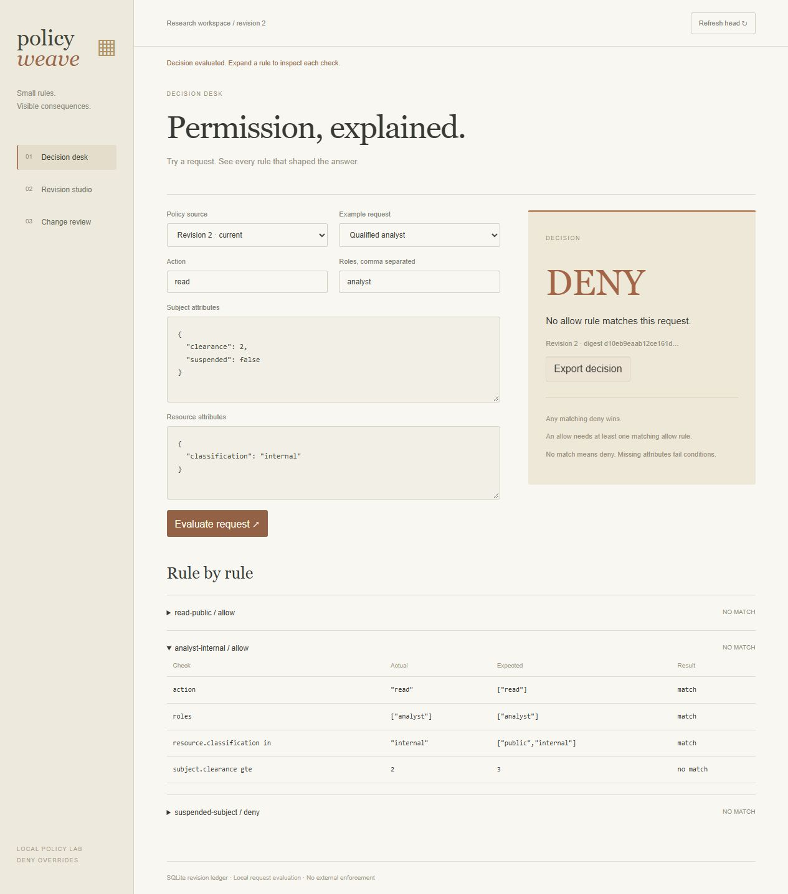
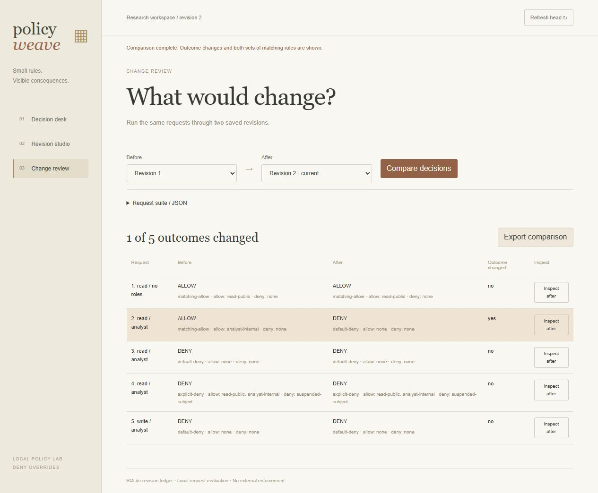

# Policy Weave

A local access-policy laboratory with immutable SQLite revisions, explained decisions, draft previews, and before/after request comparisons.



## Run

Requires Python 3.10+. No runtime dependencies, API keys, or external services.

```sh
python run.py --port 8000
```

Open http://127.0.0.1:8000/. The ignored `data/policies.sqlite3` database persists revisions. Use `--db path/to/file.sqlite3` for a separate ledger. A fresh database starts with one fictional research policy; screenshots show additional revisions created during validation.

## Three workflows

**Decision desk:** evaluate a request against a saved revision or the unsaved draft. Inspect every rule's action, role, and attribute checks, including missing values. Export the decision with its request, revision ID, and policy digest.

**Revision studio:** edit/import policy JSON, preview it with the current request, and create a revision with a note. Publication includes the expected head revision; stale writers receive a conflict. Load an older policy into the draft and publish it to restore behavior without changing history. Refreshing the head preserves the draft, while refreshing the browser discards unsaved edits.

**Change review:** compare 1–100 requests against two immutable revisions, inspect matching rules on both sides, and open any after-result in the decision desk. The changed count measures allow/deny outcome changes; matching-rule changes remain visible even when the decision is unchanged.



[Example policy](docs/example-policy.json) raises internal research clearance from 2 to 3. Against the [five example requests](docs/example-requests.json), exactly one outcome changes from allow to deny. Import the policy into a fresh ledger, publish a revision, and compare revisions 1 and 2 to reproduce this result.

## Decision semantics

Rules contain `id`, `effect`, `actions`, `roles`, and `conditions`. A rule matches when its action matches, at least one requested role matches (or `*` is configured), and every condition succeeds. `*` means any action/role, including a subject with no roles. Names are case-sensitive. Rule order has no effect on the decision.

- Any matching `deny` takes precedence over every matching allow.
- Otherwise, at least one matching `allow` grants the decision.
- Otherwise, the decision is default deny.

Conditions address flat `subject.attribute` or `resource.attribute` paths. `eq`, `neq`, and `in` use type-sensitive scalar equality, except numerically equal integer/float values compare equal. Booleans are not numbers. `gte` and `lte` require numeric policy values and numeric request attributes. Missing attributes fail every operator, including `neq`; explicit null is distinct from missing. There are no expressions, regular expressions, recursive paths, dynamic attribute references, or code execution.

This is a local policy-design tool, not an authorization enforcement point. Request attributes and roles are supplied by the caller, not authenticated identities. No external system grants or revokes access. Keep the service on loopback; it has no user authentication or multi-user permissions.

## Persistence and API

`policy.py` validates and evaluates policies. `store.py` keeps immutable revision payloads and a single head pointer. `BEGIN IMMEDIATE` serializes publication, checks the expected head, and atomically inserts the revision and advances the pointer. Any failure rolls back both changes. Requests and decisions are not stored; revisions, notes, and UTC creation times are.

Canonical JSON policy payloads receive SHA-256 digests, verified when loaded. These detect payload corruption but are not signatures or tamper-proof audit records: someone with database access can rewrite both the payload and digest. Revision notes/timestamps are not included in the policy digest.

| Endpoint | Purpose |
| --- | --- |
| `GET /api/state` | Current head and newest 100 revision metadata records |
| `GET /api/revisions/{id}` | Full immutable revision |
| `GET /api/examples` | Fictional request suite |
| `POST /api/revisions` | `{expected, policy, note}`; returns 201 or stale-head 409 |
| `POST /api/preview` | `{policy, request}`; evaluate without persistence |
| `POST /api/decide` | `{revision, request}`; explain a saved-policy decision |
| `POST /api/compare` | `{before, after, requests}`; compare two revisions |

Requests have exactly `{action, roles, subject, resource}`. Unknown fields are rejected. Errors use JSON `{error}` responses: 400 validation, 403 origin, 404 missing, 409 conflict, 413 body limit, 415 content type, 500 stored integrity failure, or 503 temporary service failure.

The server binds to 127.0.0.1, validates Host/Origin headers, requires JSON for POSTs, rejects duplicate JSON keys and nonfinite constants, and serves only allowlisted static assets. Runtime databases and source files are not exposed as assets.

## Bounds

Policies have at most 50 rules and eight conditions per rule, with 1–20 distinct actions and roles per rule. Request roles may be empty. Each request attribute section has at most 20 fields. Scalar values are null, booleans, strings up to 120 characters, or finite numbers within ±1e9. `in` accepts 1–20 scalar choices. Policy names are at most 80 characters; notes are 1–240 trimmed characters. Databases permit 2,000 revisions, with the newest 100 shown in the UI; older revisions remain accessible by API ID. HTTP request bodies are capped at 250 KB, policy-file imports at 150 KB.

## Validation

Node.js 22+ is needed only for the frontend syntax check.

```sh
python -m unittest discover -s tests -v
npm run check
```

Sixteen tests cover deny precedence, all rule permutations, missing/null distinctions, strict scalar types, boundaries, mutation isolation, 216 request combinations checked against an independent boolean oracle, durable reopening, concurrent writers, rollback after an injected head-update failure, restoration, digest corruption, stale conflicts, and HTTP validation. CI runs Python 3.11/3.13 on Ubuntu and Windows.

Browser checks covered explicit deny explanations, draft preview without persistence, revision publication, a one-of-five decision change, navigation from a comparison into detailed conditions, JSON downloads/imports, restoration as revision 3, and persistence after refresh. An independent Python calculation verified all ten exported before/after decisions, the failing clearance condition, and the canonical policy digest.
